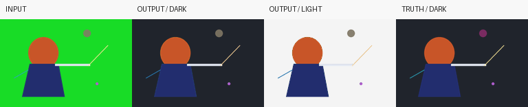

# SpriteKey

**Local green/blue screen extraction and edge cleanup, with control over fine detail.**

[简体中文](README.zh-CN.md) · [Configuration](docs/USAGE.md) · [Download v0.4.0](https://github.com/huoxuet/spritekey/releases/tag/v0.4.0) · [MIT](LICENSE)

SpriteKey turns RGB PNG sequences or video into straight-alpha RGBA PNG frames.
It combines color-screen matting, local foreground-color fitting, green/purple
fringe cleanup, and explicit protection layers for hair-like strands, thin lines
and screen-colored foreground. It runs on your computer without a model or a
network service. Video decoding uses a separately supplied FFmpeg **7.x**.



*An original generated fixture, not production artwork. Left to right: input,
recovered on dark, recovered on light, known truth on dark. Geometric examples
illustrate the workflow; they do not establish quality on every kind of footage.*

## Quick start

Python **3.10+**; Python **3.12** is recommended for a first run. These commands
install from this repository; SpriteKey is **not published to PyPI**.

macOS / Linux:

```sh
git clone https://github.com/huoxuet/spritekey.git
cd spritekey
python3 -m venv .venv
. .venv/bin/activate
python -m pip install .
python -m spritekey.demo demo-green
spritekey --config demo-green/config.json
```

Windows PowerShell, after cloning and entering the repository:

```powershell
py -3 -m venv .venv
.venv\Scripts\python.exe -m pip install .
.venv\Scripts\python.exe -m spritekey.demo demo-green
.venv\Scripts\spritekey.exe --config demo-green/config.json
```

Open `demo-green/output/preview.html` locally to inspect light, dark and checker
backgrounds, play the sequence or step through frames. Choose a **new** demo/output
directory for another run: existing output is deliberately never overwritten.
For a blue-screen example, use `python -m spritekey.demo demo-blue --screen blue`.
The generator creates its own inputs, true alpha and confidence masks.

You can also install the wheel downloaded from the Release into a fresh virtual
environment: `python -m pip install path/to/spritekey_local-0.4.0-py3-none-any.whl`.
Dependencies are resolved separately; the wheel is not a standalone executable.

## Process your own material

Use [the full configuration guide](docs/USAGE.md) and the
[PNG](src/spritekey/resources/example-png.json) /
[video](src/spritekey/resources/example-video.json) examples.
Paths in a job are relative to its JSON file. A sample ROI must contain only bare,
uniform screen in every frame. PNG inputs must be RGB8 at a consistent size.

```sh
spritekey --config job.json
spritekey --config video-job.json --ffmpeg /absolute/path/to/ffmpeg
```

- **Matte and color are separate.** The new 0.4 contour cleanup changes RGB only.
- **Fine-detail control.** Local color candidates help distinguish light strands
  from crossing dark lines. `core_masks` protects known opaque interiors;
  `preserve_rgba` applies authoritative nonzero-alpha detail byte for byte, last.
- **Keep the source geometry and timing.** No resizing, interpolation, erosion or
  small-component deletion is applied to the output matte. Known PNG timing and
  decoder-reported video PTS are recorded; unknown PNG timing remains unknown.
- **Inspect and reproduce.** Outputs include an offline preview and a completion
  manifest with frame hashes, sampled screen, settings, timing and code identity.
  A failed run retains `INCOMPLETE`, not a completed manifest.

## v0.4.0 preview

This is the first public **pre-release**. It combines the 0.3.1 detail-preserving
matte with the authorized MIT 0.2 RGB cleanup and reduces repeated candidate
computation. These are engineering combinations and optimizations of established
matting/color concepts; they are not a claim to have invented the compositing
equation or to outperform every commercial tool.

PNG package-install, regression and original-demo checks are configured in
[CI](https://github.com/huoxuet/spritekey/actions/workflows/ci.yml) for macOS,
Windows and Linux on Python 3.10/3.12. Check the actual run status; configuration
alone is not a pass. Manual real-footage and FFmpeg 7.1 validation were performed
on macOS arm64. [Validation scope](VALIDATION.md) distinguishes those results.

Uneven screens, already contaminated opaque pixels and very faint edges can still
leave residue. Automatically identifying genuine green/purple material is bounded
and heuristic; use explicit layers when fidelity is known. A single RGB composite
cannot uniquely establish both foreground color and alpha. This release is for
color-screen inputs, rather than general scene segmentation.

## Development and contributions

```sh
python scripts/verify_source.py
python -m unittest discover -s tests -v
python -m pip wheel --no-deps --wheel-dir dist .
```

Without `SPRITEKEY_TEST_FFMPEG`, **two video integration tests are skipped**;
see [contributing](CONTRIBUTING.md) to run all 28 tests with external FFmpeg 7.x.
Bug reports are welcome via [Issues](https://github.com/huoxuet/spritekey/issues).
Include a minimal shareable example and expected behavior. Do not upload private
footage or credentials; see [CONTRIBUTING.md](CONTRIBUTING.md).

## License and provenance

SpriteKey code, documentation and original geometric demos are **MIT**.
Separately installed NumPy, Pillow, OpenCV, Python and FFmpeg retain their own
licenses. No model, dependency/FFmpeg binary or production character/video asset
is bundled. See [third-party notices](THIRD_PARTY_NOTICES.md),
[source map](SOURCES.md), [implementation history](AUTHORSHIP.md) and
[algorithm](src/spritekey/resources/ALGORITHM.md).
