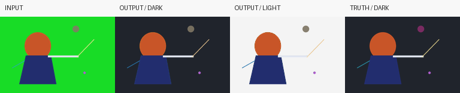

# SpriteKey

**本地绿幕／蓝幕抠像、残色精修与透明序列输出工具。**

[English](https://github.com/huoxuet/spritekey/blob/v0.4.0/README.md) · [配置说明（英文）](https://github.com/huoxuet/spritekey/blob/v0.4.0/docs/USAGE.md) · [下载 v0.4.0](https://github.com/huoxuet/spritekey/releases/tag/v0.4.0)

把 RGB PNG 序列或视频处理成原尺寸的透明 RGBA PNG 序列。结合局部前景颜色拟合、绿／紫边清理，以及可明确指定的实体与 RGBA 保护层，处理细发、细线和与色幕相近的材质。无需模型和在线服务；视频另需 FFmpeg **7.x**。



从左到右为输入、深底结果、浅底结果、深底真值。演示完全由代码绘制，仅用于说明流程，不代表所有实际素材的效果。

## 快速开始

需要 Python **3.10+**，首次使用建议 **3.12**。目前通过 GitHub 源码或 Release wheel 安装，**未发布 PyPI**。

macOS / Linux：

```sh
git clone https://github.com/huoxuet/spritekey.git
cd spritekey
python3 -m venv .venv
. .venv/bin/activate
python -m pip install .
python -m spritekey.demo demo-green
spritekey --config demo-green/config.json
```

Windows PowerShell，克隆并进入仓库后：

```powershell
py -3 -m venv .venv
.venv\Scripts\python.exe -m pip install .
.venv\Scripts\python.exe -m spritekey.demo demo-green
.venv\Scripts\spritekey.exe --config demo-green/config.json
```

打开 `demo-green/output/preview.html`，切换深／浅／棋盘格底色，播放或逐帧查看。重复运行时使用新的目录名，工具不会覆盖已有输出。蓝幕演示可用 `python -m spritekey.demo demo-blue --screen blue`。

处理自有素材：按[完整配置说明](https://github.com/huoxuet/spritekey/blob/v0.4.0/docs/USAGE.md)填写 job JSON，再运行 `spritekey --config job.json`。视频加上 `--ffmpeg /absolute/path/to/ffmpeg`。采样区必须在每帧都只有均匀裸色幕。

## 能力与边界

- 0.4 将 0.3.1 的细节 matte 与自有 MIT 0.2 的去残色步骤结合；新增去色只改 RGB，不改 Alpha。
- 不通过缩图、插帧、侵蚀或删除小连通块换取清理效果；已知时序及视频解码器报告的 PTS 保留在 manifest 中。
- `core_masks` 保护明确实体；`preserve_rgba` 最后逐字节覆盖已知细节。自动材质保色是有限范围的启发式，不能替代明确保护输入。
- 输出包含透明帧、离线预览和完成清单，记录源／结果 SHA、参数、工具身份及时间证据；失败留 `INCOMPLETE`。
- 不均匀色幕、原本已染色的实体和极弱边缘仍可能残留；本工具面向色幕，不是任意自然背景分割。

这是首个 **v0.4.0 公开预览版**。已在 macOS arm64 做实际素材与 FFmpeg 7.1 检查。macOS／Windows／Linux、Python 3.10／3.12 的 PNG 安装、回归、原创示例检查由 [CI](https://github.com/huoxuet/spritekey/actions/workflows/ci.yml)运行，实际结果以对应提交的状态为准。CI 不包含另外需要 FFmpeg 的两项测试；[验证范围](https://github.com/huoxuet/spritekey/blob/v0.4.0/VALIDATION.md)单独说明。

## 开源与反馈

工具代码、文档、原创几何演示采用 **MIT**；NumPy、Pillow、OpenCV、Python、FFmpeg 分别遵守自身许可，未捆绑它们的二进制、模型或游戏角色／视频素材。详见 [LICENSE](https://github.com/huoxuet/spritekey/blob/v0.4.0/LICENSE)、[第三方通知](https://github.com/huoxuet/spritekey/blob/v0.4.0/THIRD_PARTY_NOTICES.md)与[来源说明](https://github.com/huoxuet/spritekey/blob/v0.4.0/SOURCES.md)。

欢迎在 [Issues](https://github.com/huoxuet/spritekey/issues)提交可分享的最小复现；请先按[贡献说明](https://github.com/huoxuet/spritekey/blob/v0.4.0/CONTRIBUTING.md)检查 manifest 中的路径和私人信息。
